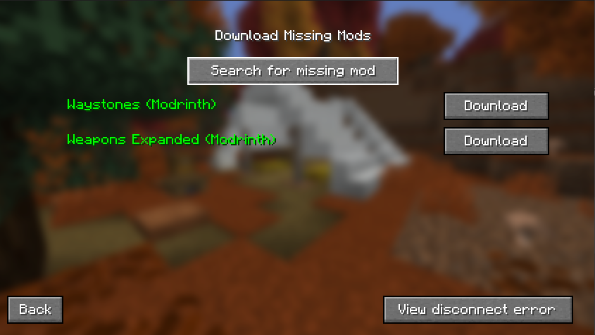
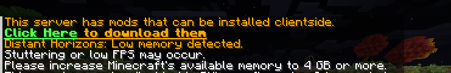

# FabricModDownloader 
Keep clients up to date with the server.

## Compatibility
Only compatible with Fabric servers, originally made for MC26.3

## Features
- Prompts players to download missing mods when they join servers
- Servers can specify mods to be excluded from suggestions
- Clients can change the directory that mods get saved to

## Setup
1. Place in mods folder
2. Restart server/client

## Commands
- Client
  - `/downloadmods` - Opens the clientside menu to download optional server mods

## Config
Server:
```yaml
excluded-mods:
    - fabric-language-kotlin
    - polymer-bundled
```
Add entries to this list corresponding to the mod id from `mods.yml`. All mods in this list will not be suggested to clients as optional mods.

Client:
```yaml
mods-directory: "custom_mods"
```
The directory within the game folder that any downloaded mods will be saved to. If absent or commented out, `"mods"` will be used.

<h2>
<details>
<summary>Images</summary>




</details>
</h2>